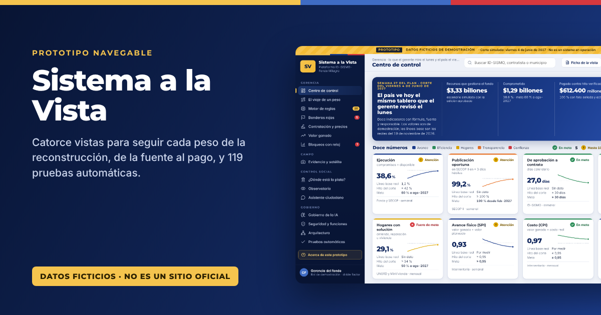

# Sistema a la Vista · prototipo navegable

> **Prototipo con datos ficticios. No es un sitio oficial ni un sistema en operación.** No pertenece al Fondo Milagro, a Fiducoldex ni al Gobierno nacional. Contratistas, montos, procesos, alertas y personas son inventados. Solo son reales las líneas base del tablero (19 de noviembre de 2026) y los límites municipales del DANE (Marco Geoestadístico Nacional 2018).

**Ábralo aquí: [https://ricaryee.github.io/ricaryee.gothub.io/sistema-a-la-vista/](https://ricaryee.github.io/ricaryee.gothub.io/sistema-a-la-vista/)**

## Qué es

Es la versión navegable de la plataforma que plantea la *Propuesta para la Gerencia del Fondo Milagro* para seguir cada peso de la reconstrucción: de la fuente al pago, con evidencia sellada, reglas que se aplican solas y control social. Todo ocurre sobre un caso simulado, el corte del viernes 4 de junio de 2027.

Es un solo archivo, sin servidor y sin cuentas. Una vez cargado funciona sin conexión.

## Cómo recorrerlo

- **En computador:** el menú de la izquierda lleva a las catorce vistas y a la de pruebas.
- **En celular o tableta:** el menú se abre con el botón de arriba a la izquierda.
- **Ficha de la vista:** el botón de arriba a la derecha explica para qué sirve cada pantalla, quién la usa, por qué es viable y qué pruebas pasa.
- **Anterior y siguiente:** al final de cada vista, para recorrerlas en orden.
- **Acerca de este prototipo:** al final del menú, vuelve a mostrar la presentación inicial.

Cada vista tiene su propio enlace, útil para compartir una pantalla puntual:

| # | Vista | Qué muestra |
|---|---|---|
| 1 | [Centro de control](https://ricaryee.github.io/ricaryee.gothub.io/sistema-a-la-vista/#tablero) | Los doce indicadores con línea base real, semáforo, mapa de los 57 municipios y bloqueos por nivel |
| 2 | [El viaje de un peso](https://ricaryee.github.io/ricaryee.gothub.io/sistema-a-la-vista/#viaje) | Los ocho pasos de la fuente al pago, la bitácora encadenada con SHA-256 y la pasarela de pago condicionado |
| 3 | [Motor de reglas](https://ricaryee.github.io/ricaryee.gothub.io/sistema-a-la-vista/#reglas) | Las doce reglas con sus activaciones y un laboratorio para dispararlas |
| 4 | [Banderas rojas](https://ricaryee.github.io/ricaryee.gothub.io/sistema-a-la-vista/#banderas) | La corrida de la noche, la cola de revisión con reloj de 48 horas y la decisión humana |
| 5 | [Contratación y precios](https://ricaryee.github.io/ricaryee.gothub.io/sistema-a-la-vista/#contratacion) | Quién aprueba según el valor en SMMLV y cada ítem contra el banco de precios regional |
| 6 | [Valor ganado](https://ricaryee.github.io/ricaryee.gothub.io/sistema-a-la-vista/#valor) | Curva S, SPI, CPI y la consecuencia automática de cada proyecto |
| 7 | [Bloqueos con reloj](https://ricaryee.github.io/ricaryee.gothub.io/sistema-a-la-vista/#bloqueos) | La escalera de cinco niveles con días hábiles y festivos de Colombia |
| 8 | [Evidencia y satélite](https://ricaryee.github.io/ricaryee.gothub.io/sistema-a-la-vista/#evidencia) | La app de obra sin conexión, la geocerca, el sello de tiempo y la comparación satelital |
| 9 | [¿Dónde está la plata?](https://ricaryee.github.io/ricaryee.gothub.io/sistema-a-la-vista/#portal) | El portal ciudadano: fuentes y usos, alertas, donaciones, mapa y descarga en OC4IDS |
| 10 | [Observatorio](https://ricaryee.github.io/ricaryee.gothub.io/sistema-a-la-vista/#observatorio) | Calidad del dato, registro de alertas con plazo y apoyos con seudónimo |
| 11 | [Asistente ciudadano](https://ricaryee.github.io/ricaryee.gothub.io/sistema-a-la-vista/#asistente) | Una conversación con autenticación, fuente citada y paso a una persona |
| 12 | [Gobierno de la IA](https://ricaryee.github.io/ricaryee.gothub.io/sistema-a-la-vista/#ia) | Los ocho usos de IA con dueño, salvaguarda y meta |
| 13 | [Seguridad y funciones](https://ricaryee.github.io/ricaryee.gothub.io/sistema-a-la-vista/#seguridad) | La separación de funciones que bloquea y registra |
| 14 | [Arquitectura](https://ricaryee.github.io/ricaryee.gothub.io/sistema-a-la-vista/#arquitectura) | Diez fuentes, una plataforma, ocho usuarios y el cronograma de 76 días |
| 15 | [Pruebas automáticas](https://ricaryee.github.io/ricaryee.gothub.io/sistema-a-la-vista/#pruebas) | Las 119 pruebas que el prototipo corre sobre sí mismo |

## Pruebas automáticas

La vista «Pruebas automáticas» ejecuta en el navegador 119 pruebas: cálculos (huellas SHA-256, festivos de Colombia, días hábiles, bandas en SMMLV, SPI y CPI), datos que deben cuadrar entre sí y operaciones (alterar un pago rompe la cadena, apagar una condición deja el hito «no pagable», certificar y pagar con la misma persona queda bloqueado). El botón «Ejecutar de nuevo» las repite.

El paquete OC4IDS que descarga el portal valida sin errores contra el esquema oficial 0.9.5 del estándar.

## Dónde se probó

- Navegadores: Chrome (y por extensión Edge y los demás basados en Chromium), Firefox y WebKit, el motor de Safari en iPhone, iPad y Mac.
- Pantallas: desde 320 px (celulares pequeños) hasta 1920 px, en vertical y en horizontal.
- En todos: sin errores, sin desbordes horizontales y con las 119 pruebas aprobadas.

## Aviso

Este repositorio publica un prototipo de demostración para revisión y comentarios. Las cifras, nombres y eventos simulados no describen la operación real de ninguna entidad.
